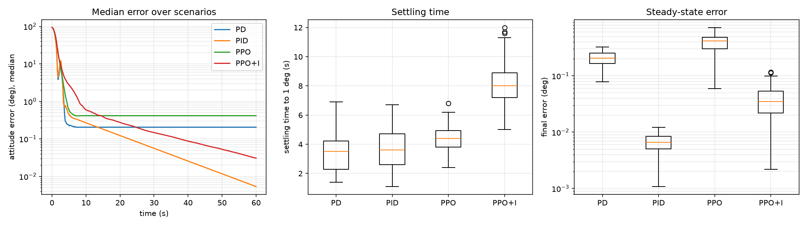

# PPO vs. PID for Spacecraft Attitude Control

A small, reproducible comparison of classical PD/PID attitude controllers and reinforcement-learning controllers (PPO) on a simulated rigid-body spacecraft with actuator limits and a constant disturbance torque.



## Summary of results

Tested on 100 random scenarios (seeds 1000–1099) that were never used for tuning or training.
Control period 0.1 s, torque limit 0.05 N·m per axis, 60 s per scenario.

| Controller | Settling time to 1° (median / 90th pct) | Final error (median) | RMS torque | Torque jerk | Settled <1° |
|---|---|---|---|---|---|
| PD (tuned) | 3.5 s / 4.9 s | 0.205° | 0.0143 N·m | 0.0007 | 100% |
| PID with anti-windup (tuned) | 3.6 s / 5.4 s | **0.007°** | 0.0139 N·m | 0.0006 | 100% |
| PPO (300k steps) | 4.4 s / 5.7 s | 0.416° | 0.0107 N·m | 0.0005 | 100% |
| PPO+I (PPO with error integral in the observation, 300k steps) | 8.0 s / 10.5 s | 0.035° | **0.0103 N·m** | **0.0004** | 100% |

Tuned gains: PD (kp=1.6, kd=0.4); PID (kp=0.8, kd=0.2, ki=0.06, integral enabled only when the error is small).

**Findings**

- With a properly tuned baseline, the classical controllers were faster than both PPO variants (about 3.5 s vs 4.4 s for PPO and 8.0 s for PPO+I, median settling time) in this setup.
- The PID's integral term removes the steady-state error caused by the constant disturbance (0.007°). Plain PPO has no memory of past error and keeps a residual error of about 0.42°. PD sits in between (0.2°).
- Giving PPO the integral of the error (PPO+I) reduced its steady-state error by roughly 12× (0.416° → 0.035°), but it is still about 5× worse than the PID, and its settling time roughly doubled: it approaches the target slowly (see the median error curve).
- Both PPO variants used about 23–28% less RMS torque and gave slightly smoother commands than PD/PID. Part of this is by design: the reward penalizes control effort, while the PD/PID gains were tuned for settling time and final error only.
- All controllers settled below 1° in every one of the 100 test scenarios.

An earlier single-scenario test with a lightly hand-tuned PID made PPO look much faster. That result was an artifact of the weak baseline and disappeared once the classical controllers were tuned properly.

## Limitations (please read before drawing conclusions)

- Simulation only: no sensor noise, actuator dynamics, flexible modes or time delays.
- The disturbance is a constant torque; no time-varying disturbances.
- Each PPO variant was trained once (seed 0, 300k steps, default hyperparameters, untuned reward weights), so seed-to-seed variance is unknown. Longer training or reward tuning could change the PPO results; the slow convergence of PPO+I in particular may depend on the reward design.
- PD/PID gains come from a small grid search on 10 training scenarios.
- No formal statistical tests were run; medians and percentiles are reported over 100 scenarios.

## Method

- **Dynamics** (`satellite_sim.py`): unit quaternion kinematics + Euler's rigid-body equations, RK4 integration. Inertia diag(0.05, 0.06, 0.04) kg·m².
- **PD/PID** (`pid_control.py`): quaternion-error feedback with shortest-rotation handling, torque saturation, and conditional-integration anti-windup.
- **RL environment** (`attitude_env.py`): Gymnasium environment. Observation = quaternion error vector (3) and angular velocity (3), plus the scaled error integral (3) for PPO+I. Action = 3-axis torque in [-1, 1]. Reward = −(|e| + 0.2|ω| + 0.05|u|²) plus a small bonus within ~1°. Random start attitude (20–150°), random initial spin, and random constant disturbance torque per episode.
- **Training** (`train_ppo.py`): Stable-Baselines3 PPO, MlpPolicy, 300k steps (~20 min on a laptop CPU).
- **Comparison** (`compare.py`): PD/PID gains tuned by grid search on 10 training scenarios (seeds 0–9); all controllers evaluated on 100 different scenarios (seeds 1000–1099). Writes `compare_results.csv` and `compare_plot.png`.

## How to run

```bash
pip install -r requirements.txt
python satellite_sim.py              # simulator sanity checks
python pid_control.py                # PD vs PID on one scenario
python train_ppo.py                  # train PPO, saves ppo_attitude.zip
python train_ppo.py --integral       # train PPO+I, saves ppo_attitude_i.zip
python compare.py                    # full comparison (add --no-ppo --quick for a fast test)
```

Tested with Python 3.13.
