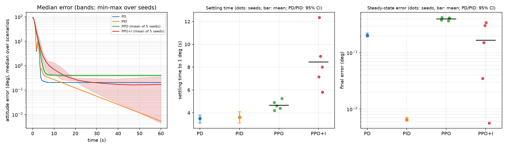

# PPO vs. PID for Spacecraft Attitude Control

A small, reproducible comparison of classical PD/PID attitude controllers and reinforcement-learning controllers (PPO) on a simulated rigid-body spacecraft with actuator limits and a constant disturbance torque. Each PPO variant was trained with five independent random seeds.



## Summary of results

Tested on 100 random scenarios (seeds 1000–1099) that were never used for tuning or training.
Control period 0.1 s, torque limit 0.05 N·m per axis, 60 s per scenario.

| Controller | Settling time to 1° (s) | Final error (°) | RMS torque (N·m) | Torque jerk (×10⁻³) |
|---|---|---|---|---|
| PD (tuned) | 3.50 [3.10–3.80] | 0.205 [0.190–0.225] | 0.0143 | 0.71 |
| PID with anti-windup (tuned) | 3.60 [3.10–4.10] | **0.0065** [0.0061–0.0072] | 0.0139 | 0.64 |
| PPO (5 seeds) | 4.67 ± 0.41 (4.20–5.25) | 0.401 ± 0.023 (0.369–0.424) | 0.0117 ± 0.0024 | 0.61 ± 0.25 |
| PPO+I (5 seeds; PPO with the error integral in the observation) | 8.45 ± 2.47 (5.80–12.35) | 0.168 ± 0.153 (0.0056–0.343) | **0.0106 ± 0.0022** | **0.49 ± 0.21** |

**Settling time and final error:** PD and PID show the median over the 100 scenarios [95% bootstrap confidence interval]; PPO and PPO+I show the mean ± standard deviation over the five training seeds of each seed's median (range of the seed medians in parentheses). **RMS torque and jerk:** means over the 100 scenarios; no confidence interval was computed for PD and PID, and for PPO and PPO+I the ± is the standard deviation across seeds of each seed's scenario mean. The comparison is descriptive; no significance tests were performed.
Tuned gains: PD (kp=1.6, kd=0.4); PID (kp=0.8, kd=0.2, ki=0.06, integral enabled only when the error is small).

**Findings**

- With a properly tuned baseline, the classical controllers were faster than both PPO variants in this setup. Even the fastest PPO seed (4.2 s) was slower than the upper ends of the PD/PID confidence intervals (a descriptive observation, not a significance test).
- The PID's integral term removes the steady-state error caused by the constant disturbance (0.0065°). Plain PPO has no memory of past error and kept a residual error of about 0.40° in all five seeds. PD sits in between (0.2°).
- Giving PPO the integral of the error (PPO+I) lowered its mean steady-state error about 2.4× (0.40° → 0.17°), but results vary strongly between seeds: from 0.0056° (matching the PID) to 0.343°. Settling is also slower and more variable (8.5 ± 2.5 s).
- A first single-seed run (seed 0) had suggested a 12× error reduction for PPO+I. The five-seed study shows this was a favorable draw: single-seed RL comparisons can overstate a benefit.
- On average the RL agents used about 16–18% (PPO) and 24–26% (PPO+I) less RMS torque than PD/PID, and gave smoother commands. Part of this is by design: the reward penalizes control effort, while the PD/PID gains were tuned for settling time and final error only. The advantage is not uniform: one PPO seed used more torque (0.0159 N·m) than either classical controller.
- Paired comparison (averaged over seeds): the PID settled strictly faster than PPO in 82% and than PPO+I in 98% of the scenarios, and had a lower final error in 100% and 87%, respectively.

An earlier single-scenario test with a lightly hand-tuned PID made PPO look much faster. That result was an artifact of the weak baseline and disappeared once the classical controllers were tuned properly.

## Limitations (please read before drawing conclusions)

- Simulation only: no sensor noise, actuator dynamics, flexible modes or time delays.
- The disturbance is a constant torque; the test scenarios come from the same distribution used to train the PPO agents, so generalization to other conditions was not assessed.
- Five training seeds per variant is a small sample, so the standard deviations are themselves uncertain. The results are reported descriptively: no significance tests were run and no claim of statistical significance is made.
- PD/PID gains come from a small grid search on 10 tuning scenarios; PPO hyperparameters (defaults) and reward weights were not tuned. Longer training or reward changes could change the PPO results; the slow, variable convergence of PPO+I in particular may depend on the reward design.

## Method

- **Dynamics** (`satellite_sim.py`): unit quaternion kinematics + Euler's rigid-body equations, RK4 integration. Inertia diag(0.05, 0.06, 0.04) kg·m².
- **PD/PID** (`pid_control.py`): quaternion-error feedback with shortest-rotation handling, torque saturation, and conditional-integration anti-windup.
- **RL environment** (`attitude_env.py`): Gymnasium environment. Observation = quaternion error vector (3) and angular velocity (3), plus the scaled error integral (3) for PPO+I. Action = 3-axis torque in [-1, 1]. Reward = −(|e| + 0.2|ω| + 0.05|u|²) plus a small bonus within ~1°. Random start attitude (20–150°), random initial spin, and random constant disturbance torque per episode.
- **Training** (`train_ppo.py`, `train_all_seeds.py`): Stable-Baselines3 PPO, MlpPolicy, 300k steps (~20 min per model on a laptop CPU).
- **Single-seed comparison** (`compare.py`): grid-search tuning of PD/PID on 10 tuning scenarios (seeds 0–9) and evaluation of the seed-0 PPO models on the 100 test scenarios; writes `compare_results.csv` and `compare_plot.png`.
- **Multi-seed analysis** (`compare_seeds.py`): evaluates all trained seeds on the same 100 test scenarios and reports bootstrap confidence intervals (PD/PID), mean ± std across seeds (PPO), and paired win rates; writes `seed_results.csv` and `seed_plot.png`.

## How to run

```bash
pip install -r requirements.txt
python satellite_sim.py              # simulator sanity checks
python pid_control.py                # PD vs PID on one scenario
python train_ppo.py                  # train PPO (seed 0), saves ppo_attitude.zip
python train_ppo.py --integral       # train PPO+I (seed 0), saves ppo_attitude_i.zip
python train_all_seeds.py            # train seeds 1-4 for both variants (~20 min per model)
python compare.py                    # single-seed comparison (add --no-ppo --quick for a fast test)
python compare_seeds.py              # multi-seed analysis (results are cached in seed_cache/)
```

Tested with Python 3.13.
